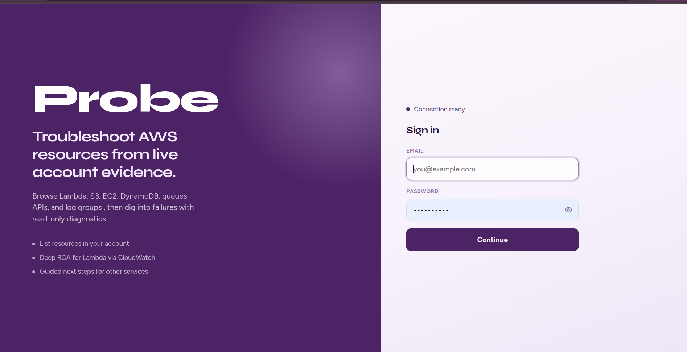
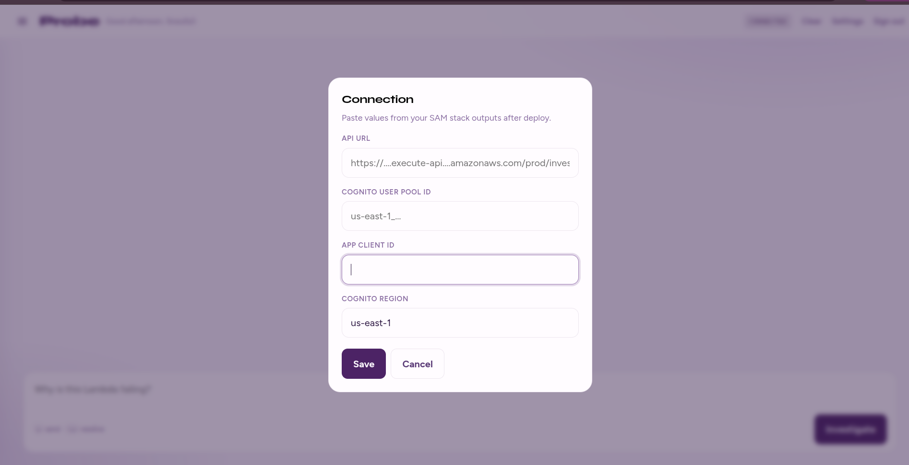
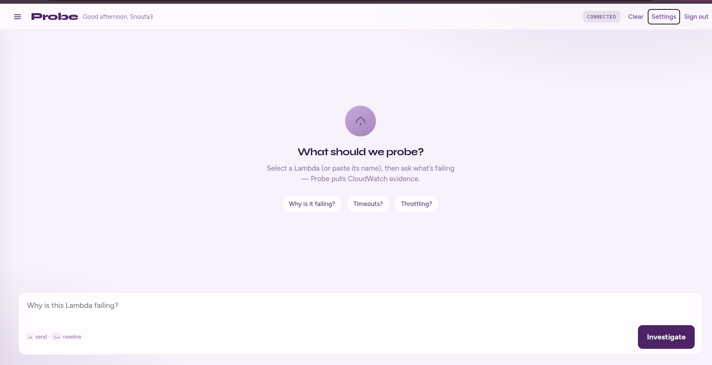
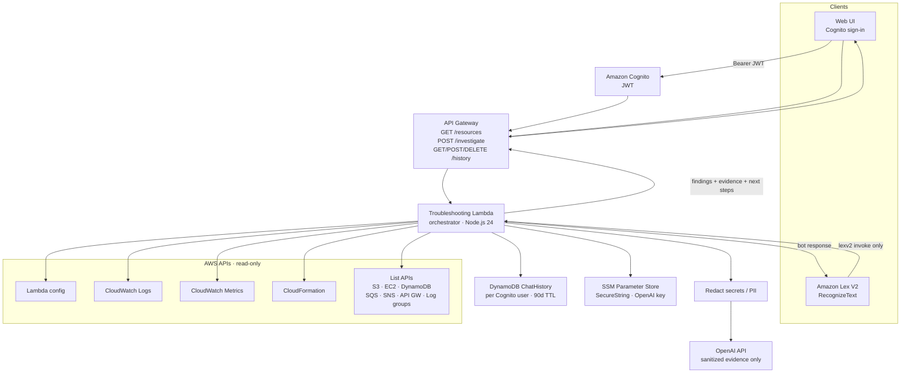

# Probe

Account-aware AWS troubleshooting assistant. SAM app (TypeScript / `tsc`) that investigates **your** AWS resources (read-only), then uses OpenAI for evidence-based root-cause analysis.

**Scope (v1):** one account, one region (`us-east-1` by default), list resources (Lambda/S3/EC2/DynamoDB/SQS/SNS/API Gateway/Log groups), investigate Lambda errors via CloudWatch + optional CloudFormation, Lex V2 + HTTP API.

## Screenshots

### Sign in



### Connection settings

Paste Cognito and API Gateway stack outputs once (saved in the browser, or via `ui/config.js`).



### Investigate

Select a Lambda, ask what’s failing, and get evidence-backed findings.



## Architecture



## Security

- **API auth (Cognito):** `POST /investigate` and `/history` require a valid Cognito JWT (`Authorization: Bearer …`). Unauthenticated requests get `401`.
- **Chat history:** stored in DynamoDB keyed by Cognito `sub` (not shared across users). Turns expire after **90 days** (TTL).
- **Lex:** the orchestrator Lambda is only invokable by `lexv2.amazonaws.com`. Talking to the Lex bot requires AWS IAM (`lex:RecognizeText`) — it is not a public anonymous endpoint.
- **Read-only** diagnostics — no restart, deploy, delete, or modify permissions (history table is the exception: put/query/delete for the caller’s own turns).
- **Least-privilege IAM** on the execution role.
- **Redaction** of keys, tokens, JWTs, emails, and private keys before OpenAI calls.
- **OpenAI key** in SSM Parameter Store (`SecureString`) only (never in Git or frontend).
- Log collection uses a **time window** and **event limit** to control cost.

## Project layout

```
template.yaml          # SAM: Lambda, API, Lex bot, IAM
Makefile               # sam build → npm ci + tsc
package.json
tsconfig.json
src/
  app.ts               # Lex + API + direct invoke handler
  history.ts           # DynamoDB chat history (per Cognito user)
  alarms.ts            # GET /alarms — CloudWatch alarms + state reasons
  orchestrator.ts
  redact.ts
  openaiClient.ts
  collectors/
ui/                    # Browser chat UI (Cognito + investigate + history)
public/                # README screenshots
events/                # Sample payloads
tests/
```

## Web UI

Static chat client in `ui/` — Cognito sign-in, browse account resources, deep-investigate Lambda errors, guided checks for other services, and **restored chat history** from DynamoDB.

```bash
# from repo root (any static server)
npx --yes serve ui -p 5173
# open http://localhost:5173
```

1. Click **Configure API & Cognito** (or Settings) and paste stack outputs:
   - `InvestigateApiUrl`
   - `UserPoolId`
   - `UserPoolClientId`
   - region (e.g. `us-east-1`)
2. Sign in with the Cognito user you created after deploy.
3. Pick a **resource type** and **region** — the Target panel loads resources from your account. Select a Lambda, then ask why it is failing.
   - `GET /resources?type=lambda&region=us-east-1` (same Cognito JWT as investigate)
4. Prior turns reload via `GET /history` after sign-in. **Clear** removes the transcript and deletes your saved turns (`DELETE /history`).
   - Investigate responses are saved server-side (full findings + evidence).
   - Guided (non-Lambda) turns are saved via `POST /history`.
5. **Alarms** page (topbar → Alarms) lists CloudWatch alarms with the recorded state reason:
   - `GET /alarms?region=us-east-1&state=ALARM`
   - Click an alarm to jump into Investigate with that context (and the linked Lambda when present).

### Connection config: Settings UI vs `config.js`


| Approach | When to use |
|----------|-------------|
| **Settings / Connection UI** | Default for clones and public repos. Paste stack outputs once; values live in browser `localStorage`. No secrets or account-specific URLs in Git. |
| **`ui/config.js`** | Optional bake-in for a known private deploy. Copy `ui/config.example.js` → `ui/config.js`, fill `InvestigateApiUrl`, `UserPoolId`, `UserPoolClientId`, and region. Settings can still override. |

Load order: `config.js` defaults → overridden by Settings (`localStorage`).

`ui/config.js` is **gitignored** so local filled values are not committed. Keep committing only `ui/config.example.js`.

Stack outputs also include `HistoryApiUrl`, `ChatHistoryTableName`, and `AlarmsApiUrl`.

## Build (no deploy)

```bash
npm ci
npm run build          # tsc
npm test
sam validate --lint
sam build              # Makefile builder packages dist + prod deps
```

Before deploy, copy `samconfig.toml.example` → `samconfig.toml` and set your stack name, region, and `OpenAIParameterName` (that file is gitignored).

## Local invoke (optional)

```bash
sam build
sam local invoke TroubleshootingFunction -e events/direct-investigate.json
```


